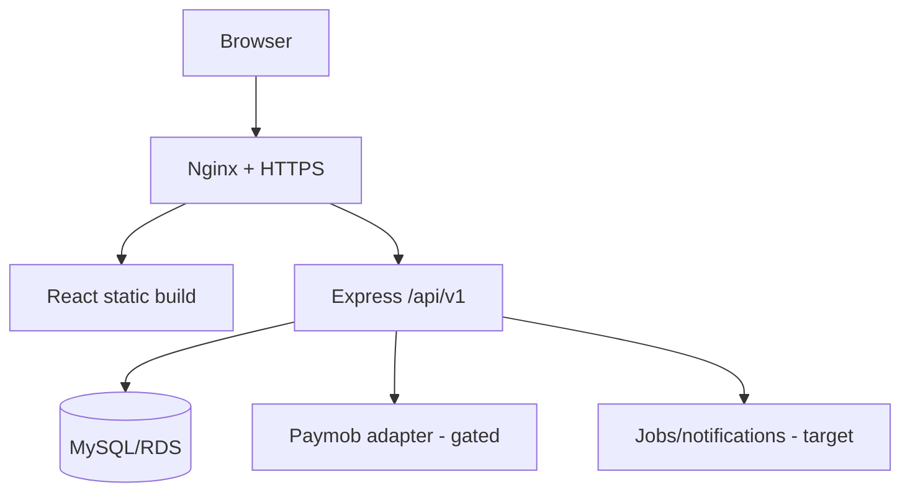

# System Architecture and Decisions

**Purpose:** Current topology and formal ADRs  
**Applies to:** USAM Communities React/Node.js/EC2 package  
**Sources:** audited source at commit lineage `03ea43c...`, Universal Blueprint v1.1, supplied master prompt, official sources ledger  
**Status:** CURRENT + TARGET

## Current target

ADR-001 retain modular monolith; ADR-002 versioned REST; ADR-003 httpOnly sessions; ADR-004 admin-created official communities; ADR-005 Paymob candidate with hosted payment and signed webhooks; ADR-006 no raw card storage; ADR-007 Sites mode remains device-local and transparent; ADR-008 multi-tenant architecture deferred until organization isolation requirements are approved.

