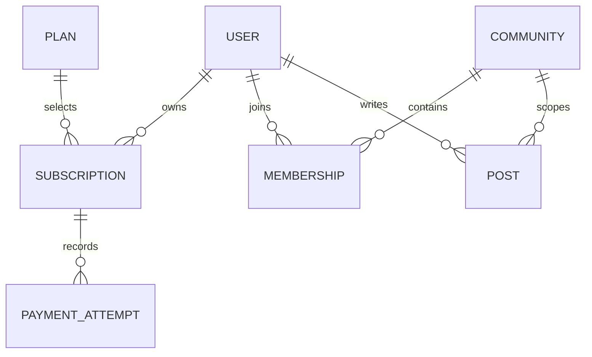

# Database Schema, ERD and Lifecycle

**Purpose:** Current 28-model design and target data controls  
**Applies to:** USAM Communities React/Node.js/EC2 package  
**Sources:** audited source at commit lineage `03ea43c...`, Universal Blueprint v1.1, supplied master prompt, official sources ledger  
**Status:** CURRENT + TARGET

Current domains include users/sessions, communities/memberships, social graph/content, events/registrations, offers/claims, organizations, mentorship, messaging, challenges, moderation/audit/contact and plans/subscriptions/payment attempts.

Classify email/session/payment references as confidential. Store no raw card data. Define production migrations instead of `sync()`; encrypt transport and storage; support account export/deletion; retain financial/audit records only for approved legal periods. Backup target assumption: daily encrypted backup, RPO 24h, RTO 8h until business owners approve stricter objectives.

