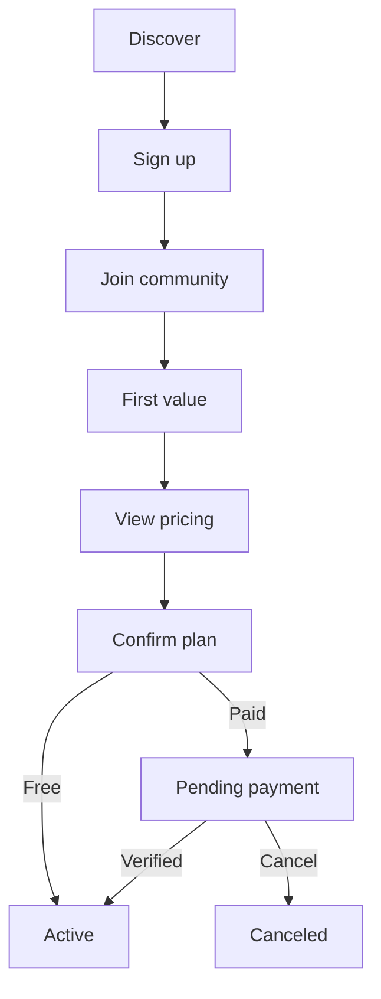

# User Flows and Information Architecture

**Purpose:** Major journeys and recovery paths  
**Applies to:** USAM Communities React/Node.js/EC2 package  
**Sources:** audited source at commit lineage `03ea43c...`, Universal Blueprint v1.1, supplied master prompt, official sources ledger  
**Status:** CURRENT + TARGET

Recovery: unauthenticated protected routes preserve redirect; invalid plan returns clear error; duplicate paid request returns same subscription; provider not configured creates no fake payment; cancellation changes status and pending attempts. Support and legal routes remain available without authentication.

