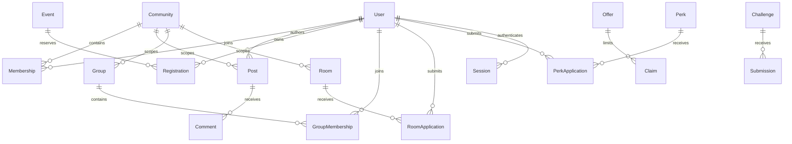

# Backend, API and data

## Runtime

Express 5 API, Sequelize 6, bcrypt password hashes, opaque server-side sessions, MySQL production target and SQLite for isolated development/tests. Production calls `authenticate()` only; schema creation requires explicit empty-database bootstrap.

## API surface

Prefix: `/api/v1`. Implemented groups: health; signup/login/logout/logout-all; profile and summary; communities and membership; posts/comments/reactions/bookmarks/reports; events, waitlists, ticket codes and check-in; offers and claims; paid-member perks and perk applications; organizations and teams; groups/chapters; curated rooms/applications/check-in/feedback; partnerships; saved searches; notification preferences; mentors and mentorship; challenges and submissions; follows/blocks/messages; search; notifications; activity; platform config; CMS; feature flags; contact; admin review/publishing.

Perks endpoints are `GET /perks`, `GET /my-perk-applications`, `POST /perks/:id/apply`, `GET /admin/perks`, `GET /admin/perk-applications` and `PATCH /admin/perk-applications/:id`. The catalog endpoint and page are public and live in the marketing shell outside the dashboard. Applying requires an active paid subscription; signed-out visitors receive a sign-in handoff and signed-in free members receive a pricing handoff. External-program entries are application assistance only and never represented as guaranteed approval or an undisclosed partnership.

The detailed route list remains in `docs/API_CONTRACTS.md`. JSON failures return `{error}`. Cookie sessions are httpOnly, SameSite=Lax and Secure in production.

## Data domains

Additional models: Perk, PerkApplication, Organization, OrganizationMember, Partnership, SavedSearch, NotificationPreference, FeatureFlag, CmsEntry, Mentor, MentorRequest, Conversation, Message, Follow, Block, Notification, Report, AuditLog and ContactRequest. Important unique constraints cover membership, reaction, bookmark, registration, claim, perk application per user/perk, submission, follow, block, conversation pair, group membership, room application, organization membership, feature flag key and CMS key/locale.

## Concurrency and idempotency

Event registration and cancellation are handled in a database transaction with capacity, waitlist promotion and unique ticket-code check-in. Curated-room acceptance enforces capacity and application uniqueness. Offer claims use a transaction, a unique user/offer constraint and an atomic quantity check. Perk applications are unique per user/perk and follow an admin-controlled review state machine. Partnership transitions follow an explicit server-side state machine. Paid events are rejected. Webhook idempotency does not exist because no payment or external webhook integration is enabled.

## Migration boundary

No versioned migration set exists. `db:bootstrap` is only for a new empty schema. Existing Hub data, any PostgreSQL history and all E-USAM records must remain untouched until backup, mapping, reconciliation and explicit production approval are available.

