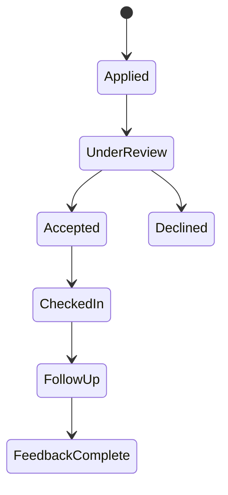

# Persona and curated experience flows

## LaunchPad

Current: community, founder-oriented feed, guides, Founder Readiness program, Customer Discovery Room, founder event, challenge and mentor discovery. Next: startup profiles, opt-in investor introductions, cofounder matching and accelerator application states.

## FreelanceSpace

Current: community, portfolio guides, Freelance Proof program, portfolio room, clinic event, perk and Freelancing product gateway. Next: structured portfolio entities, service briefs, client workspaces and consented product handoff.

## HR Connect

Current: community, role scorecard guide, People Operations Lab, hiring systems room, roundtable, organizations and Jobs gateway. Next: verified employer representative roles, opt-in talent search, hiring-event organizer workflow and scoped organization tenancy.

## StudentZone

Current: community, learning sprint guide, Campus to Career program, project room, build night, campus challenge and Education/Jobs gateways. Next: campus chapter entities, chapter managers, Education badge API and internship handoff contract.

## Curated room state target

Only the catalog and journey explanation exist today. Application, review, grouping, invitation, QR check-in, consented introductions, feedback and follow-up persistence remain missing.

