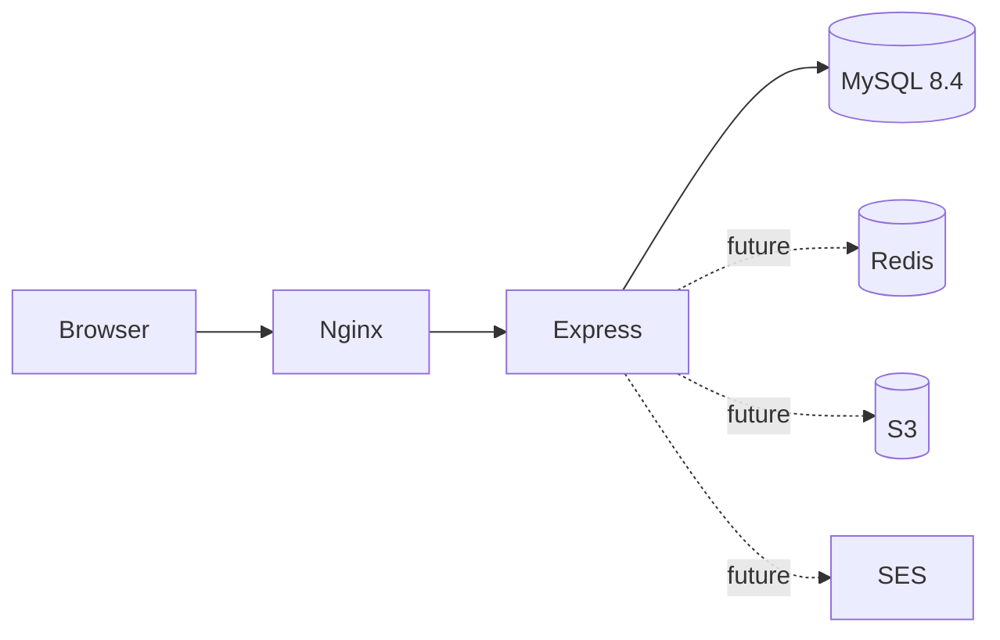

# AWS and release runbook

## Intended topology

Current package includes React static output, Express/PM2 configuration and Nginx proxy configuration. Redis is present only in the development compose file and is unused by the API.

## Safe release sequence

1. Verify source/branch/commit and clean secrets scan.
2. Run `npm ci`, `npm run check`, dependency audit and isolated MySQL tests.
3. Provision a new environment only after cost and security approval.
4. Capture database and application backups; verify restore path.
5. Apply reviewed versioned migrations to staging; reconcile counts/FKs/UTF-8.
6. Deploy static assets and API, run health and smoke checks.
7. Observe errors, latency and database health before traffic shift.
8. Roll back application version on failure; use forward migrations for applied schema changes.

## Explicit gates

Do not change DNS, issue public TLS, provision paid RDS/Redis, write production DB data, touch `13.49.49.246`, or deploy to `13.48.137.19` without current access, backup evidence and explicit production approval. E-USAM remains isolated.

